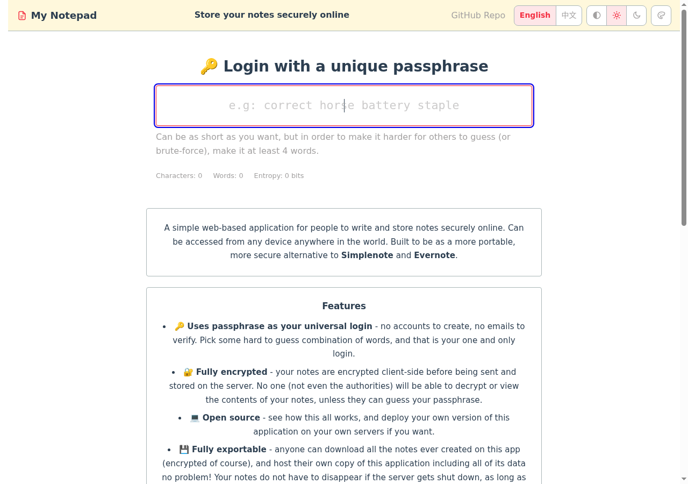
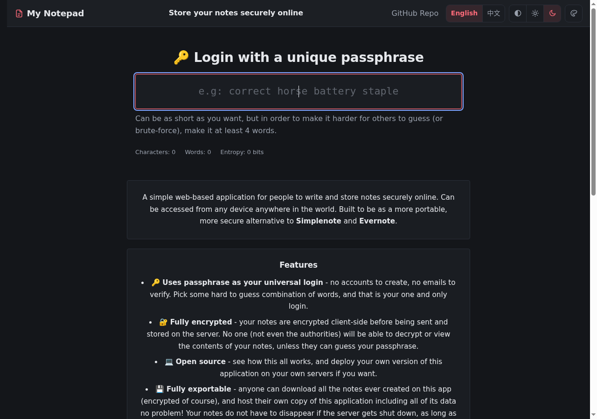

# Theme gallery

Twelve themes, each with a light and a dark palette — 24 looks in total.
Two independent axes: **mode** (`SITE_THEME` = `auto` / `light` / `dark`) and **skin** (`SITE_SKIN`).

The images below are real screenshots of the running app (1280×900, home page).
A visitor who picks a theme in the header keeps it (stored in the browser) and it wins over the
default injected by the deployment.

[中文版](README.zh.md)

| # | `SITE_SKIN` | Name | What it is | Light | Dark |
|---|---|---|---|---|---|
| 1 | `classic` | Classic | Default: modern teal with an orange action colour |  |  |
| 2 | `original` | Original (upstream) | The upstream look: white + cornsilk header + red brand + Trebuchet MS + 4px corners |  |  |
| 3 | `paper` | Paper | Warm paper tones, serif type, 6px corners |  |  |
| 4 | `ocean` | Ocean | Blue |  |  |
| 5 | `forest` | Forest | Green |  |  |
| 6 | `grape` | Grape | Purple |  |  |
| 7 | `sunset` | Sunset | Warm orange-red |  |  |
| 8 | `mono` | Mono | No colour, monospace, 4px corners |  |  |
| 9 | `neon` | Neon | High-contrast violet/cyan |  |  |
| 10 | `bento` | Bento | **Changes the layout**: tile grid, hint + stats as two blocks, header shrinks on scroll |  |  |
| 11 | `glass` | Glass | **Glassmorphism**: gradient backdrop with star dots, frosted translucent cards |  |  |
| 12 | `fluid` | Fluid | **Adaptive**: fluid type and spacing, mobile theme panel becomes a bottom sheet, safe-area aware |  |  |

## How to use one

```bash
# .env
SITE_THEME="dark"      # auto (default) / light / dark
SITE_SKIN="glass"      # any id from the table above
```

The home page, the backups page and the 403 page all follow it. Anything a visitor picks in the
header (mode + skin) is remembered in their browser and takes precedence over these defaults.

## Adding a theme

- **Colours only** → one entry in the `skins` array of `frontend/src/theme.js`
  (`id`, a label in every locale pack, and a light + dark token set).
- **Layout or behaviour too** → drop a module under `frontend/src/themes/`:
  `<id>.css` (structural styles, every selector scoped under `html[data-skin="<id>"]`) plus
  `<id>.js` (optional behaviour, exporting `onApply()`), then register one line in `THEME_HOOKS`
  in `theme.js`. `themes/bento.{css,js}` is the working template.

The palettes live in exactly one place; the server-rendered pages read a build-time export of the
same data (`dist/themes.json`).
